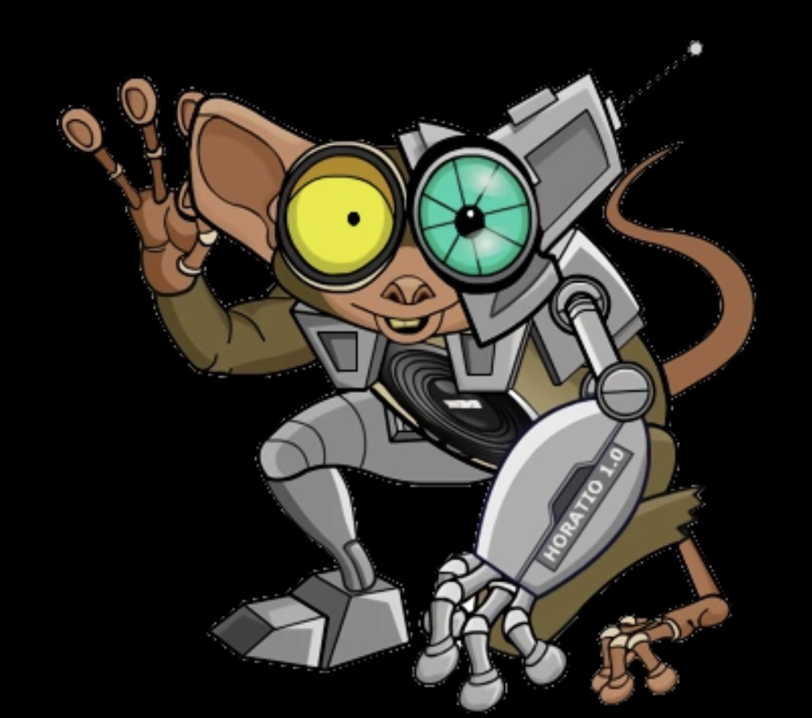

# Horatio AI

**Small bot. Big personality.**

Horatio is a local-first AI companion for Discord and Minecraft, with persistent memory, research, voice and a personality of his own.

## Follow the development

- **[Visit the project hub](https://thatmonitorcord.github.io/Horatio-AI-Hub/)**
- [Release notes](CHANGELOG.md)
- [Roadmap](ROADMAP.md)
- [Development updates](UPDATES.md)
- [Questions and ideas](https://github.com/ThatMonitorCord/Horatio-AI-Hub/discussions)
- [Report a public-facing issue](https://github.com/ThatMonitorCord/Horatio-AI-Hub/issues)

This repository contains the public project website and documentation. Application source, private development records and packaged builds remain private.

Current application release: **1.47.2**. Roadmap items are priorities, not promised delivery dates.

When sharing feedback, describe what happened and what you expected. Do not post credentials, private conversations or unredacted logs.
